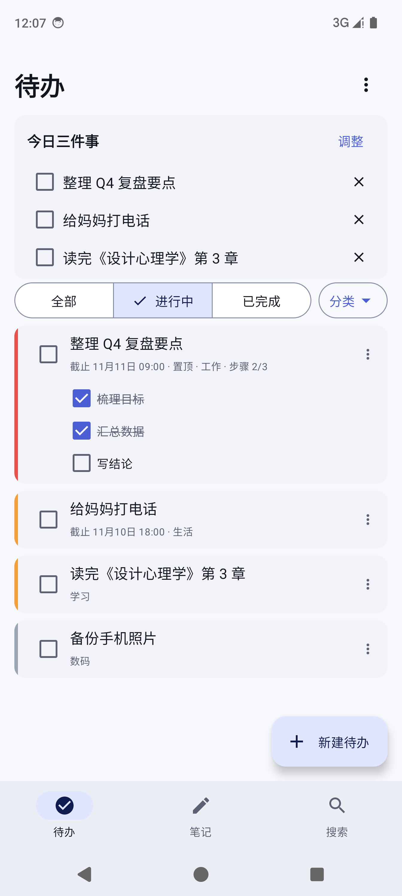
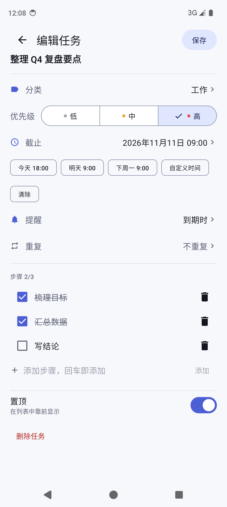
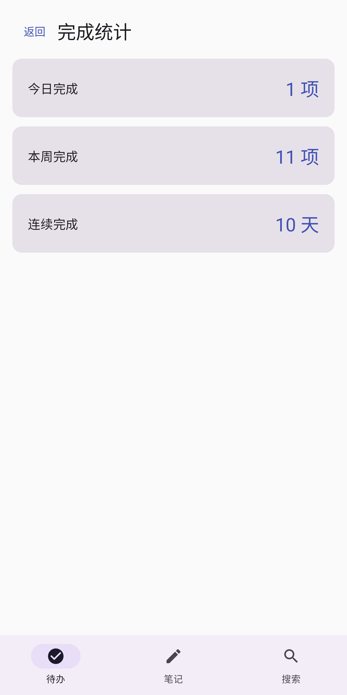
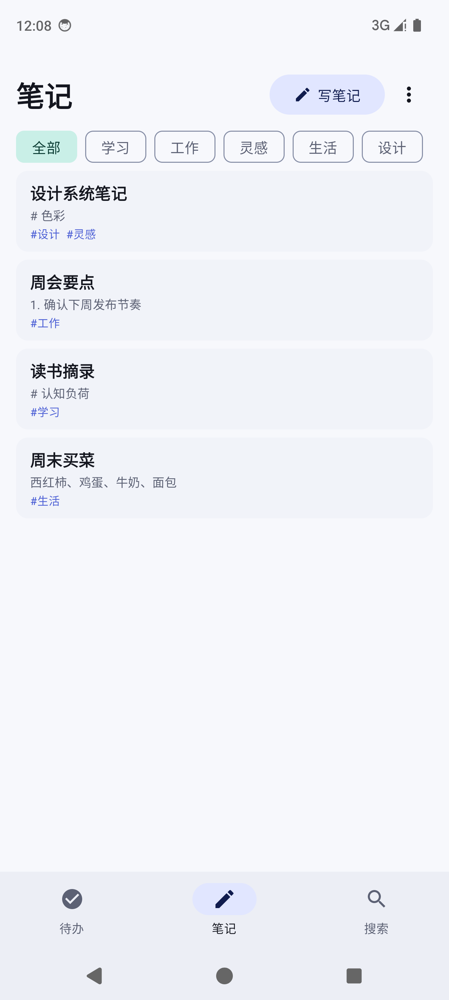
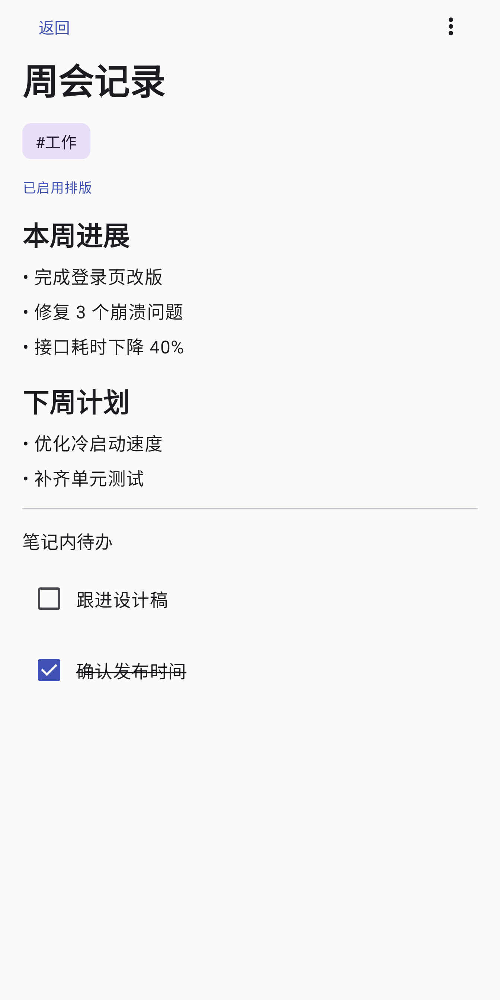
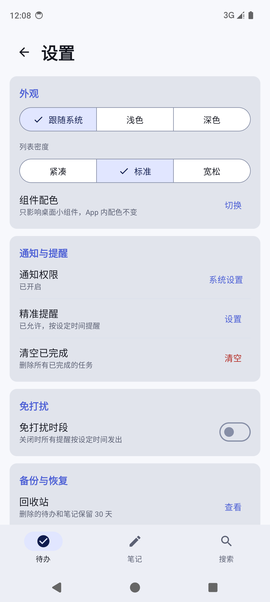

<div align="center">


# Jotlist

**待办 · 笔记 · 每天自动循环**

一款克制的 Android 待办 + 笔记应用。没有账号，没有广告，没有云端。

[](https://github.com/likebe1-1/jotlist/actions/workflows/android.yml)
-3DDC84)


</div>


## 功能

- **今日三件事**：从所有待办里挑出今天最重要的 3 件，专注在真正要做的事上
- **重复任务自动循环**：「每天 / 每周 / 每月」只有一条任务，完成后标记完成，到了下个周期**自动变回未完成**，不复制副本
- **子步骤**：把一件事拆成几步，逐步推进
- **到点提醒**：提前提醒 + 免打扰时段 + 通知栏三个快捷操作（完成 / 10 分钟后 / 明天）
- **笔记与待办互通**：Markdown 笔记内可插入待办条目
- **日历视图与完成统计**：按日期查看安排，统计今日、本周、连续完成天数
- **外观可调**：浅色 / 深色 / 跟随系统，三种列表密度
- **桌面小组件 · 待办**：2×2 / 4×2 / 4×4 三套布局按尺寸自动切换，条数少时字号自动放大，深浅色主题、系统圆角、RTL 与平板/折叠屏随桌面自适应，可直接勾选任务
- **桌面小组件 · 笔记**：独立的青碧配色组件，列出最近笔记，点条目直达对应笔记、点「记」快速收集
- **完全离线**：不申请 `INTERNET` 权限，数据只存在本机

## 截图

| 待办 | 任务编辑 | 完成统计 |
|:---:|:---:|:---:|
|  |  |  |

| 笔记列表 | 笔记详情 | 设置 |
|:---:|:---:|:---:|
|  |  |  |

## 下载

从 [Releases](../../releases) 页面下载最新的 `Jotlist-x.y.apk` 直接安装（Android 8.0 及以上）。

> Google Play 版本使用 AAB 分发，回滚与签名由 Play 托管。

## 构建

环境要求：JDK 17+、Android SDK 35。

```bash
# 调试包
./gradlew :app:assembleDebug

# 单元测试
./gradlew :app:testDebugUnitTest

# 仪器测试（需要已连接的设备或模拟器）
./gradlew :app:connectedDebugAndroidTest

# 发布包（需要在根目录放 keystore.properties）
./gradlew :app:bundleRelease      # Google Play 用 AAB
./gradlew :app:assembleRelease    # 侧载用 APK
```

小组件的三套尺寸布局可以在调试包里直接走查（不需要往桌面拖）：

```bash
adb shell am start -n com.manst.jotlist/.WidgetPreviewActivity
adb shell am start -n com.manst.jotlist/.WidgetPreviewActivity --ez pin true  # 直接弹出"添加到主屏幕"
```

签名配置从项目根目录的 `keystore.properties` 读取（已被 `.gitignore` 排除）：

```properties
storeFile=jotlist-release.jks
storePassword=******
keyAlias=jotlist
keyPassword=******
```

## 项目结构

```
app/src/main/java/com/manst/jotlist/
├── MainActivity.kt          # 壳：主题、底部导航、一次性启动指令
├── TodoScreen.kt            # 待办列表、全屏任务编辑器、日历、统计、整理
├── NotesScreen.kt           # 笔记列表 / 编辑器 / Markdown 渲染 / 时间线
├── SearchScreen.kt          # 待办 + 笔记统一搜索
├── SettingsScreen.kt        # 外观、通知、免打扰、关于
├── WelcomeScreen.kt         # 首次启动品牌页
├── TodoModels.kt            # 数据模型与枚举
├── TodoStorage.kt           # SharedPreferences + JSON 持久化
├── TodoLogic.kt             # 纯逻辑：重复周期、免打扰、日期工具（有单测）
├── Reminders.kt             # 闹钟、通知、快捷操作、开机恢复
├── UiDensity.kt             # 列表密度设计参数
└── TodoWidgetProvider.kt    # 桌面小组件
```

核心逻辑（`TodoLogic.kt`）没有 Android 依赖，可以直接跑 JVM 单元测试；
UI 层用 Compose 仪器测试覆盖主要流程。

## 隐私

不收集任何数据：不申请网络权限、无账号、无广告、无第三方 SDK。
已关闭 Android 自动备份（`allowBackup=false`），待办与笔记不会进入系统云备份或设备迁移备份。
详见 [隐私政策](release-assets/privacy-policy.md)。

## 许可证

[MIT](LICENSE)
